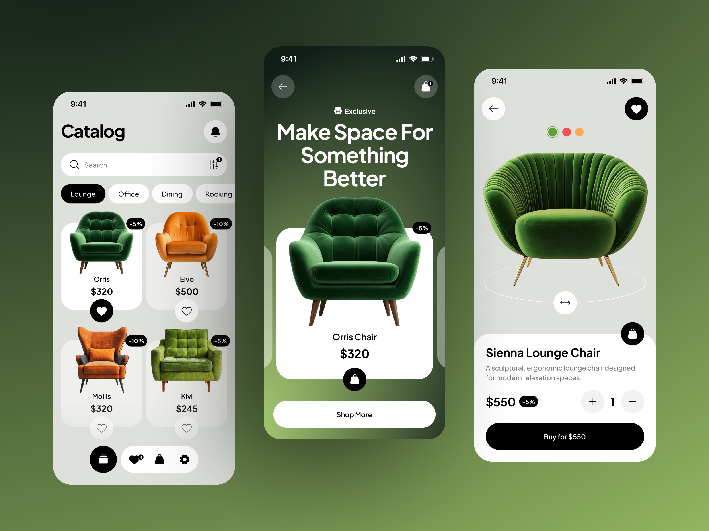

# Furniture Marketplace App UI

A modern, minimal Flutter e-commerce UI concept for an architectural furniture marketplace, inspired by modern design trends on Dribbble.

Focused on clean typography, tactile micro-interactions, fluid Hero transitions, and editorial product presentation.

---

## Design Inspiration



---

## Highlights & Interactions

- **Interactive Product Showcase & Hero Flights**: Smooth shared element Hero animation transitions each product card seamlessly from the catalog grid into the high-resolution showcase.
- **Micro-Interactions & Animated CTA**: Three-stage interactive Buy button that transitions smoothly from purchase to order confirmation and into continue shopping with tailored cubic easing.
- **Top In-App Notification Banner**: Native-style slide-down purchase confirmation notification synchronized with button state transitions.
- **Architectural Typography**: Clean hierarchy paired with Plus Jakarta Sans and minimal monochrome accents.
- **Floating Navigation Bar**: Freestanding action buttons with real-time favorite counter and filter states.

---

## Running Locally

Ensure you have Flutter installed on your machine:

```bash
flutter pub get
flutter run
```
